# 계정 탈취 대응 상태기계 · Account Protection State Machine

게임 계정이 탈취됐을 때의 대응 절차를 **상태기계**로 모델링하고, 그 규칙을 애플리케이션 코드가 아니라 **PostgreSQL**(제약조건 · 트리거 · 행 잠금 · 권한)이 강제하도록 만든 계정 보호 시스템입니다. 요청이 어떤 코드 경로로 들어와도, 심지어 DB 소유자 계정으로 직접 `UPDATE`를 실행해도 정책을 우회할 수 없습니다.

`PostgreSQL 17` · `PL/pgSQL` · `Python 3.10` · `Django 5.2` · `psycopg 3` · `pytest`
Database Design and System 텀프로젝트 (개인 프로젝트, 2026년 10월~)

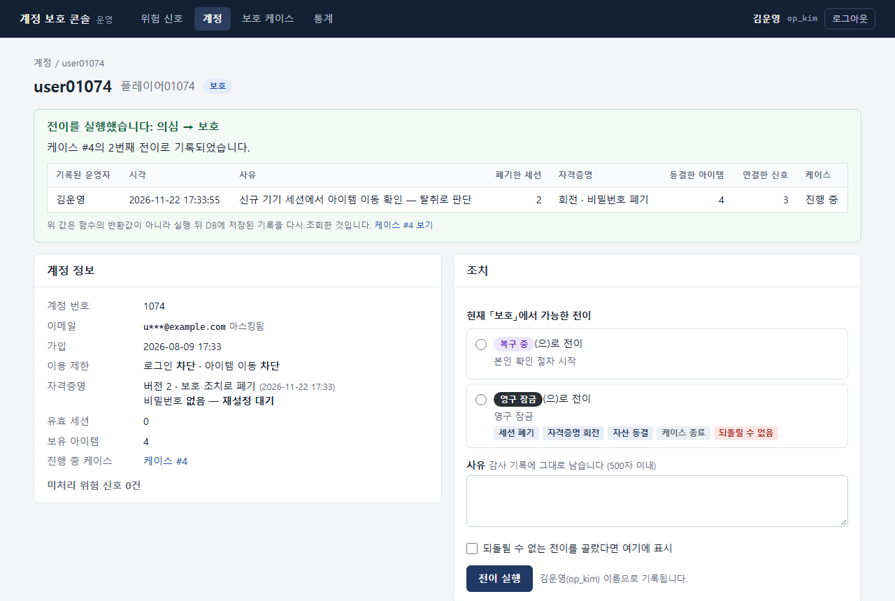

## 한눈에 보기

| | |
|---|---|
| **다룬 문제** | 계정 탈취 대응은 세션 끊기 · 비밀번호 무효화 · 아이템 동결이 **한꺼번에**, 공격자의 요청과 **경합하면서** 일어나야 한다. 하나라도 빠지거나 순서가 어긋나면 그 틈으로 아이템이 빠져나간다. |
| **접근** | 정책을 DB 한 곳에 모았다. 앱 계정은 테이블을 직접 바꿀 권한이 없고 정책 함수만 호출한다. 허용 전이는 세 겹(함수 · 트리거 · 외래키)으로, 기록 없는 상태 변경은 커밋 시점 트리거로 막는다. |
| **경합 제어** | 모든 정책 함수가 같은 순서로 계정 행을 먼저 잠근다. 실제 DB 연결 두 개로 경합을 재현해 잠금 대기를 관찰하고, 잠금을 뺀 비교 함수에서는 write skew가 재현되는 것까지 테스트로 확인한다. |
| **운영 화면** | Django 운영 콘솔. 위험 신호 큐 → 계정 감사 타임라인 → 상태 전이 → 보호 케이스 → 통계. 거부된 요청은 사유와 함께 "데이터가 바뀌지 않았다"는 전후 비교를 보여 준다. |
| **규모** | 테이블 18 · PK 18 / FK 29 / UNIQUE 11 + 부분 UNIQUE 1 / CHECK 27 · 정책 함수 5 · 트리거 2 · 뷰 4 · 자동 테스트 75 |
| **데이터** | 합성 데이터만 사용 — 계정 1,500 · 로그인 시도 약 3만 · 세션 약 1.6만 · 아이템 7,550. 빈 서버에서 스키마 적용과 적재까지 약 10초. |

## 목차

1. [문제 정의 — 왜 DB에서 강제하나](#1-문제-정의--왜-db에서-강제하나)
2. [상태기계](#2-상태기계)
3. [아키텍처와 DB 역할](#3-아키텍처와-db-역할)
4. [핵심 설계](#4-핵심-설계)
5. [운영 콘솔 (Django)](#5-운영-콘솔-django)
6. [데이터 모델](#6-데이터-모델)
7. [테스트](#7-테스트)
8. [실행 방법](#8-실행-방법)
9. [프로젝트 구조](#9-프로젝트-구조)
10. [알려진 한계와 다음 단계](#10-알려진-한계와-다음-단계)
11. [수업 산출물과 문서 생성](#11-수업-산출물과-문서-생성)

---

## 1. 문제 정의 — 왜 DB에서 강제하나

전형적인 탈취 시나리오: 공격자가 유출된 비밀번호로 로그인 실패를 몇 번 낸 뒤 낯선 기기에서 로그인에 성공하고, 보유 아이템을 수집용 계정으로 옮긴다. 운영자가 이를 발견해 계정을 「보호」 상태로 바꾼다. 이때 생기는 위험과 이 프로젝트의 대응은 다음과 같다.

| 위험 | 예 | 대응 (어디서 막나) | 검증 |
|---|---|---|---|
| **부분 실행** | 세션은 끊었는데 비밀번호가 그대로라 공격자가 다시 로그인 | 동반 조치를 전이와 **한 트랜잭션**에서 실행. 하나라도 실패하면 전부 롤백 | `test_protect_revokes_sessions_rotates_credential_and_snapshots_items` |
| **경합 (TOCTOU)** | 보호 조치가 커밋되기 직전에 공격자의 아이템 이동이 끼어들어 승인됨 | 계정 행 **잠금 규약** (상태 변경 = 배타, 상태 확인 = 공유) | `tests/test_concurrency.py` |
| **우회** | 관리 스크립트 · 다른 서비스 · 버그가 검사 없이 상태를 바꾸거나 기록 없이 바꿈 | 최소 권한 + **트리거 2개** + 외래키. 소유자 계정의 직접 `UPDATE`도 거부 | `test_owner_cannot_*`, `test_ops_role_cannot_bypass_functions` |
| **부인** | "그 조치 내가 한 거 아니다", 기록 삭제 | 모든 전이에 운영자 · 사유 · 시각. 참조되는 기록은 **삭제 금지**(RESTRICT) | `test_operator_who_acted_cannot_be_deleted` |
| **과다 노출** | 운영자가 이메일 원문 · 비밀번호 해시 · 세션 토큰을 열람 | 열 단위 권한 + **마스킹 뷰**. 비밀번호는 bcrypt, 토큰 · 기기 식별값은 SHA-256만 저장 | `test_ops_sees_masked_email` |
| **계정 탐색** | 로그인 응답 차이로 존재하는 아이디를 알아냄 | 없는 아이디는 별도 결과(`INVALID_CREDENTIALS`)로만 돌려주고 기록하지 않음 | `test_unknown_login_id_does_not_reveal_existence` |

앱 코드에서 이 검사들을 하면, 검사를 거치지 않는 경로가 하나만 생겨도 정책이 깨진다. 그래서 **정책을 집행하는 지점을 DB 하나로** 두고, 앱(운영 화면 · 게임 서버)은 DB가 허락한 함수만 부르게 했다.

## 2. 상태기계

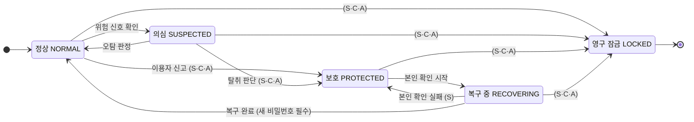

동반 조치 — **S** 유효 세션 전부 폐기 · **C** 자격증명 회전(버전 +1, 비밀번호 무효화) · **A** 보유 아이템 동결(스냅샷)

| 상태 | 새 로그인 | 아이템 이동 | 보호 케이스 |
|---|:---:|:---:|---|
| 정상 | 허용 | 허용 | 들어오면 종료 |
| 의심 | 허용 | 허용 | 진행 (오탐일 수 있어 이용은 막지 않고 지켜본다) |
| 보호 | 차단 | 차단 | 진행 |
| 복구 중 | 차단 | 차단 | 진행 |
| 영구 잠금 | 차단 | 차단 | 들어오면 종료 (종착 상태) |

전이 규칙, 동반 조치, 상태별 허용 정책은 코드가 아니라 **테이블 데이터**(`allowed_transition`, `protection_state`)다. 정책 함수도 운영 화면도 이 테이블을 읽어 동작하므로, 정책을 바꿀 때 코드를 고치지 않는다. 「영구 잠금」이 종착 상태라는 것도 별도 플래그가 아니라 "그 상태에서 나가는 행이 없다"는 데이터 사실이다.

「정상」에서 벗어나는 순간 **보호 케이스**가 열리고 그 계정의 미처리 위험 신호가 연결된다. 「정상」이나 「영구 잠금」으로 들어가면 케이스가 닫힌다. 케이스 하나에 "누가 · 언제 · 왜 · 어떤 조치를 했는지"가 순서대로 남는다.

## 3. 아키텍처와 DB 역할

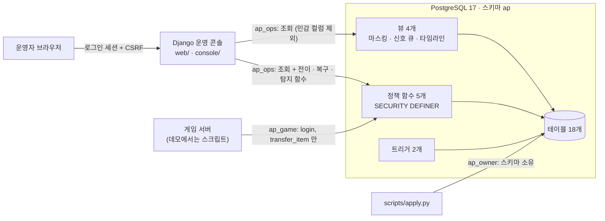

| DB 역할 | 쓰는 곳 | 할 수 있는 것 | 할 수 없는 것 |
|---|---|---|---|
| `ap_owner` | 마이그레이션 (`scripts/apply.py`) | 스키마 소유 | 앱은 이 역할을 쓰지 않는다 |
| `ap_ops` | Django 운영 콘솔 | 테이블 조회(이메일 · 비밀번호 해시 · 토큰 해시 컬럼 제외), 뷰 조회, `transition_account` · `reset_password` · `detect_risks` 실행 | 모든 `INSERT` / `UPDATE` / `DELETE`, 민감 컬럼 조회 |
| `ap_game` | 게임 서버 | `login`, `transfer_item` 실행 | 그 밖의 모든 것 (조회 포함) |

정책 함수 5개:

| 함수 | 하는 일 |
|---|---|
| `login(login_id, password, device_key, platform, ip)` | 계정 상태 · 비밀번호 확인 → 기기 등록 → 세션 발급(12시간) → 시도 기록 → 그 계정 탐지 실행 |
| `transfer_item(session_token, item_id, to_account_id)` | 세션 유효성 · 계정 상태 · 거래 가능 여부 · 소유권 확인 → 이동 또는 사유와 함께 거절. **거절도 기록** |
| `transition_account(account_id, to_state, operator_id, reason)` | 허용 전이 확인 → 케이스 열기 · 찾기 → 전이 기록 → 동반 조치 → 상태 변경 → 필요하면 케이스 종료 |
| `reset_password(account_id, new_password, operator_id)` | 「복구 중」에서만, 8자 이상, 자격증명 버전 +1 |
| `detect_risks(account_id, since)` | 로그인 이력에서 규칙(실패 폭주 · 신규 기기)을 평가해 위험 신호 생성 |

## 4. 핵심 설계

### 4.1 허용 전이를 세 겹으로 강제

| 층 | 장치 | 막는 것 |
|---|---|---|
| ① 정책 함수 | `transition_account`가 `allowed_transition`을 조회 | 정상 경로의 잘못된 요청 |
| ② BEFORE 트리거 | `trg_account_state_guard` — `account.state_code` 변경 시 허용 전이인지 검사 | 함수를 거치지 않는 직접 `UPDATE` (소유자 계정 포함) |
| ③ 복합 외래키 | `case_transition(from_state, to_state) → allowed_transition` | 허용되지 않은 전이 **기록**의 위조 |

하나만으로는 "직접 UPDATE"와 "기록 위조"를 함께 막지 못해서 세 곳에 두었다. 단, 스키마 변경 권한으로 트리거 자체를 끄는 것은 막을 수 없으므로 소유자 계정은 마이그레이션에만 쓴다.

### 4.2 기록 없는 상태 변경 차단 — 지연 제약 트리거

허용된 전이라도 `case_transition` 기록 없이 상태만 바꾸면 안 된다. 그런데 "같은 트랜잭션 안에 기록이 있는가"는 행 단위 BEFORE 트리거로는 알 수 없다(기록이 상태 변경보다 먼저일 수도, 나중일 수도 있다). 그래서 `trg_account_state_recorded`를 `DEFERRABLE INITIALLY DEFERRED` 제약 트리거로 만들어 **커밋 시점에** "계정의 현재 상태 = 마지막으로 기록된 전이의 도착 상태"인지 검사한다.

```sql
CREATE CONSTRAINT TRIGGER trg_account_state_recorded
    AFTER UPDATE OF state_code ON account
    DEFERRABLE INITIALLY DEFERRED
    FOR EACH ROW
    WHEN (OLD.state_code IS DISTINCT FROM NEW.state_code)
    EXECUTE FUNCTION trg_account_state_recorded();
```

### 4.3 동반 조치의 원자성과 "복구에는 새 비밀번호가 필요하다"

`transition_account`는 전이 기록 · 세션 폐기 · 자격증명 회전 · 자산 동결 · 상태 변경 · 케이스 종료를 한 트랜잭션에서 실행한다. 「복구 중 → 정상」 규칙("새 비밀번호를 정해야 복구 완료")은 함수 안의 `IF`가 아니라 CHECK 제약으로 표현했다.

```sql
CONSTRAINT ck_account_password_required
    CHECK (password_hash IS NOT NULL OR state_code IN ('PROTECTED', 'RECOVERING', 'LOCKED'))
```

로그인할 수 있는 상태(정상 · 의심)의 계정은 비밀번호가 있어야 한다. 보호 전이는 비밀번호를 무효화(`NULL`)하므로, 새 비밀번호 없이 「정상」으로 가려는 순간 이 CHECK가 위반되고 **전이 기록과 케이스 종료까지 통째로 롤백**된다. 운영 콘솔은 이 거부를 받아 요청 전후 값을 나란히 보여 준다 ([5장 거부 화면](#5-운영-콘솔-django)).

### 4.4 경합 제어 — 계정 행 잠금 규약

모든 정책 함수는 **계정 행을 가장 먼저** 잠근다. 상태를 바꾸는 쪽(`transition_account`, `reset_password`)은 `FOR UPDATE`(배타), 상태를 확인하는 쪽(`login`, `transfer_item`)은 `FOR SHARE`(공유). 같은 계정의 상태 변경과 로그인 · 이동은 반드시 하나씩 순서대로 처리되고, 잠금 순서가 항상 같아 교착 위험도 줄어든다.

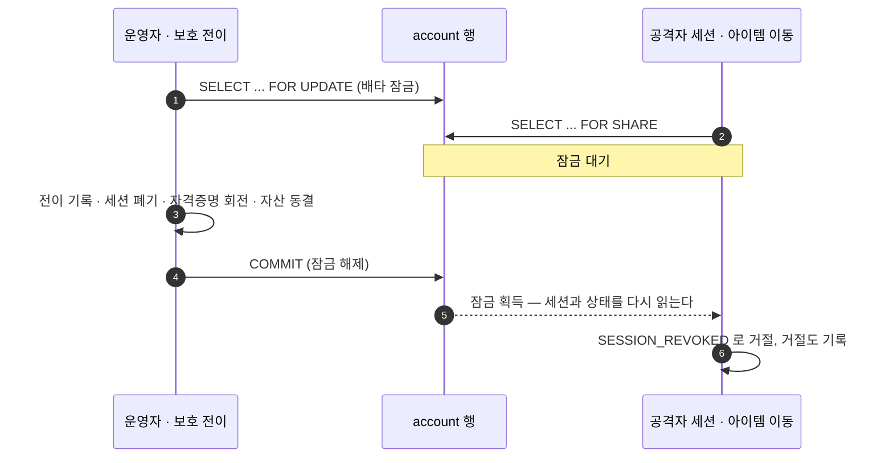

`transfer_item`은 잠금을 얻은 **뒤에** 세션을 다시 읽는다. 기다리는 동안 커밋된 세션 폐기를 반영하기 위해서다. 같은 아이템의 동시 이동은 조건부 `UPDATE ... WHERE owner_account_id = 보내는 계정`으로 한 번만 성공한다.

이 규약이 왜 필요한지는 **잠금만 뺀 비교 함수**(`lab/01_transfer_nolock.sql`, 검사와 실행 사이에 1.5초 지연)로 실험했다. 실제 DB 연결 두 개를 열고, 한쪽이 커밋하지 않은 상태에서 다른 쪽을 실행해 `pg_stat_activity`로 잠금 대기를 확인한다.

| 구현 | 격리 수준 | 보호 전이 도중의 아이템 이동 결과 |
|---|---|---|
| 잠금 규약 (`transfer_item`) | READ COMMITTED | 이동이 잠금을 기다린 뒤 `SESSION_REVOKED`로 거절. 아이템은 동결 목록에 그대로 |
| 잠금 규약 (반대 순서: 이동이 먼저) | READ COMMITTED | 보호 전이가 기다린 뒤 실행. 이미 옮겨진 아이템은 동결 목록에서 빠짐 |
| 잠금 없음 | READ COMMITTED | **write skew** — 보호 이후 이동이 승인되고, 동결 목록은 그 아이템을 "보유 중"으로 기록 |
| 잠금 없음 | REPEATABLE READ | **write skew** — 같은 이상 현상 |
| 잠금 없음 | SERIALIZABLE | 늦게 끝난 이동이 직렬화 실패로 취소 |

마지막 줄이 보여 주듯 SERIALIZABLE도 이상 현상을 막지만, 실패한 쪽을 앱이 재시도해야 한다. 이 프로젝트는 업무 규칙("같은 계정의 상태 변경과 이용은 순서대로")을 잠금으로 직접 표현하는 쪽을 택했다.

### 4.5 세션 무효화 — 버전 비교

세션이 유효하려면 `미폐기 ∧ 미만료 ∧ 발급 당시 자격증명 버전 = 계정의 현재 버전`이어야 한다. 자격증명을 회전하면 버전이 올라가므로, 세션 행을 하나하나 고치지 않아도 그 계정의 **모든 기존 세션이 즉시 무효**가 된다. 폐기 표시(`revoked_at`)는 감사용 기록이고, 판정은 버전 비교만으로도 성립해 경합에 강하다.

### 4.6 최소 권한과 함수 보안

- 정책 함수 5개는 `SECURITY DEFINER`(소유자 권한 실행)이고, 모두 `SET search_path = ap, ext, pg_temp`를 고정해 다른 스키마에 같은 이름의 객체를 끼워 넣는 공격을 막는다.
- PostgreSQL은 새 함수에 `PUBLIC` 실행 권한을 주므로 먼저 `REVOKE EXECUTE ... FROM PUBLIC` 한 뒤 역할별로 필요한 함수만 허용한다.
- `ap_ops`의 `account` · `game_session` 조회 권한은 **열 단위**로 준다. 이메일은 소유자 권한으로 실행되는 마스킹 뷰(`v_account_overview`)로만 볼 수 있다: `user01074@example.com` → `u***@example.com`.
- 실험용 취약 함수(`lab` 스키마)는 운영 · 게임 역할에 실행 권한이 없다.

### 4.7 비밀정보 저장

| 값 | 저장 방식 |
|---|---|
| 비밀번호 | bcrypt (`pgcrypto`의 `crypt` + `gen_salt('bf')`) |
| 세션 토큰 | 32바이트 난수. 원문은 호출자에게 한 번만 돌려주고 DB에는 SHA-256만 저장 |
| 기기 식별값 | SHA-256만 저장 |

해시 컬럼은 `char(64)`인데, `char`는 짧은 값도 공백을 채워 받아들인다. 그래서 `CHECK (token_hash ~ '^[0-9a-f]{64}$')`로 형식을 강제한다. 운영 콘솔은 DB 매개변수를 서버 측에서 바인딩해, 비밀번호 재설정이 거부될 때 PostgreSQL 오류 로그의 SQL 문에 입력한 비밀번호 대신 `$2`가 남는다(기본 로그 설정에서 확인).

### 4.8 감사 기록 보존과 삭제 정책

- 외래키 29개 중 28개가 `ON DELETE RESTRICT ON UPDATE RESTRICT`. 다른 기록이 참조하는 행은 지울 수 없다. 삭제가 필요한 업무는 상태로 표현한다(계정 → 영구 잠금, 운영자 → `is_active`, 탐지 규칙 → `is_enabled`, 세션 → `revoked_at`, 케이스 → `closed_at`).
- 예외는 하위 타입 `burst_signal → risk_signal` 하나(`ON DELETE CASCADE`). 하위 타입 행은 별개의 기록이 아니라 같은 신호의 속성을 나눠 담은 것이라 함께 지운다.
- `SET NULL`은 쓰지 않는다. 이 스키마에서 `NULL`은 이미 뜻이 있다(운영자 `NULL` = 시스템 자동 전이, 케이스 `NULL` = 미처리 신호, 폐기 원인 `NULL` = 로그아웃). 부모가 지워질 때 `NULL`로 바꾸면 기록이 다른 뜻으로 읽힌다.
- 다른 컬럼에서 계산되는 값(`login_attempt.success`, `item_transfer.result`, `game_session.revoke_reason` 등 5개)은 `GENERATED ALWAYS AS ... STORED` 생성 컬럼으로 만들어, 원본과 어긋난 값을 쓸 수 없게 했다.

### 4.9 탐지 규칙

- **실패 폭주**: 같은 계정의 로그인 실패가 10분 안에 5회에 **처음 도달한** 시도에 신호 1건. 윈도 함수 `count(*) OVER (... RANGE BETWEEN interval PRECEDING AND CURRENT ROW)`로 구간 실패 수를 세고, `lag()`로 직전 값과 비교해 임계치를 넘는 순간만 고른다. 6번째, 7번째 실패마다 신호가 쏟아지지 않는다.
- **신규 기기**: 신뢰하지 않는 기기에서의 **첫** 로그인 성공에 신호 1건.
- `UNIQUE (rule_code, trigger_attempt_id)` + `ON CONFLICT DO NOTHING` 이라 탐지를 몇 번 다시 실행해도 신호가 중복되지 않는다.
- 기간 · 임계치 · 심각도 · 사용 여부는 `risk_rule` 테이블 데이터다. 실패 폭주 규칙에서 기간이나 임계치가 비면 탐지가 오류를 내거나 조용히 꺼지므로 CHECK로 필수화했다.
- `login` 함수가 매 로그인마다 그 계정만 탐지하고, 운영 콘솔에서 전체 이력을 일괄 탐지할 수도 있다.

## 5. 운영 콘솔 (Django)

운영자가 위험 신호를 확인하고, 계정의 감사 기록을 보고, 상태를 전이하는 웹 화면이다. 화면은 정책을 **다시 구현하지 않는다**. 요청을 정책 함수에 그대로 넘기고, DB가 거부하면 그 사유를 사람이 읽을 수 있는 말로 바꿔 보여 준다.

| 화면 | 내용 |
|---|---|
| 위험 신호 | 미처리 신호를 심각도 · 발생 시각 순으로. 상태별 계정 수, 규칙별 필터, 전체 탐지 실행 |
| 계정 목록 · 상세 | 검색(ID · 닉네임 · 번호), 마스킹된 이메일, 이용 제한, 자격증명 상태, 미처리 신호 |
| 상태 전이 | 현재 상태에서 **허용된 전이만** 선택지로, 각 전이의 동반 조치와 "되돌릴 수 없음" 표시. 사유 필수 |
| 감사 타임라인 | 로그인 · 위험 신호 · 상태 전이 · 세션 폐기 · 아이템 이동을 한 줄로 (5개 테이블을 합친 뷰) |
| 세션 · 기기 · 아이템 | 폐기된 세션에서 원인 전이로 이동, 같은 기기를 쓴 다른 계정 수 |
| 보호 케이스 | 전이 기록, 연결된 신호, 동결 자산과 현재 소유자 비교 |
| 복구 | 「복구 중」 계정에 새 비밀번호 설정 |
| 통계 | 상태별 계정 수, 규칙별 신호 수(`ROLLUP` 합계), 전이별 · 운영자별 처리 건수, 평균 처리 시간 |
| 거부 화면 | 거부 사유 · 막은 곳(함수 / CHECK / 권한 …) · **요청 직전과 직후의 DB 값 비교** |

| 위험 신호 큐 | 계정 상세 · 허용된 전이 |
|---|---|
| 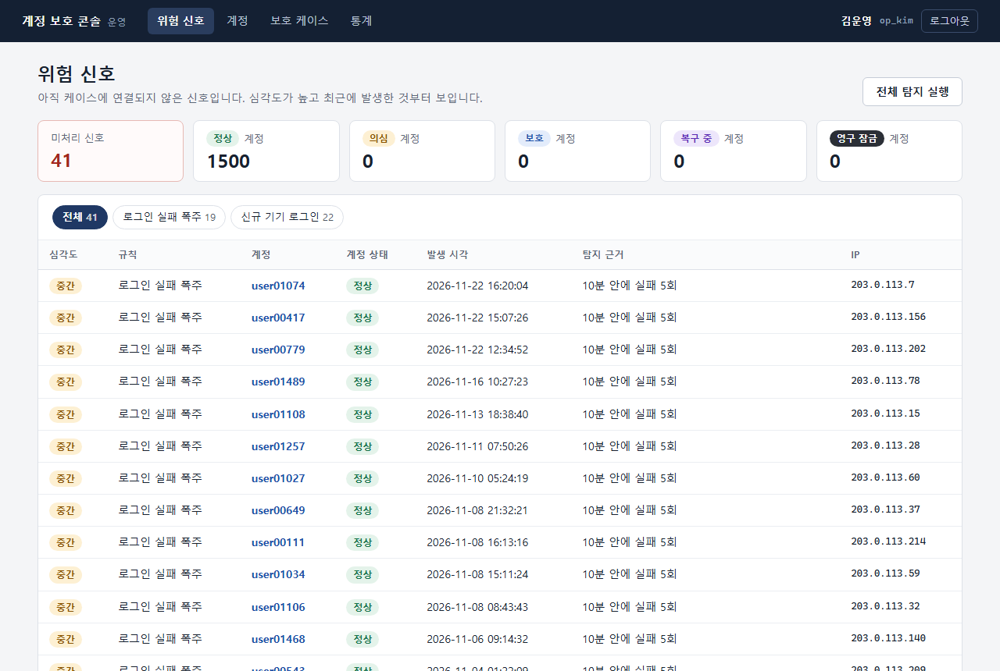 | 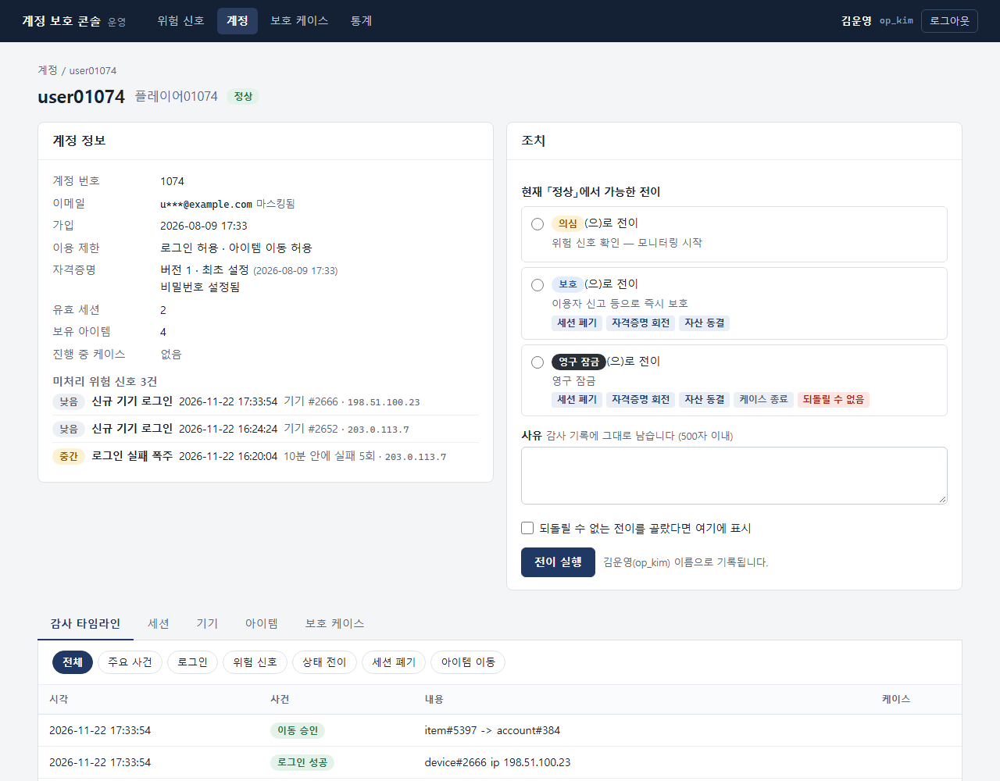 |
| **거부 화면 — 새 비밀번호 없이 복구 완료 시도** | **보호 케이스 — 전 과정 기록** |
| 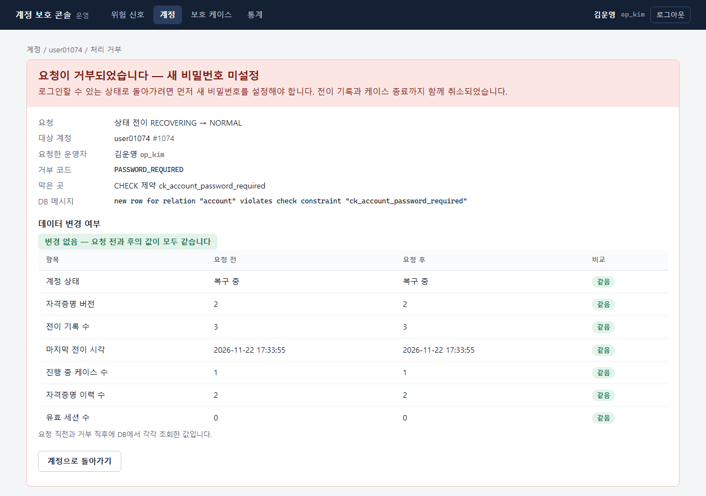 | 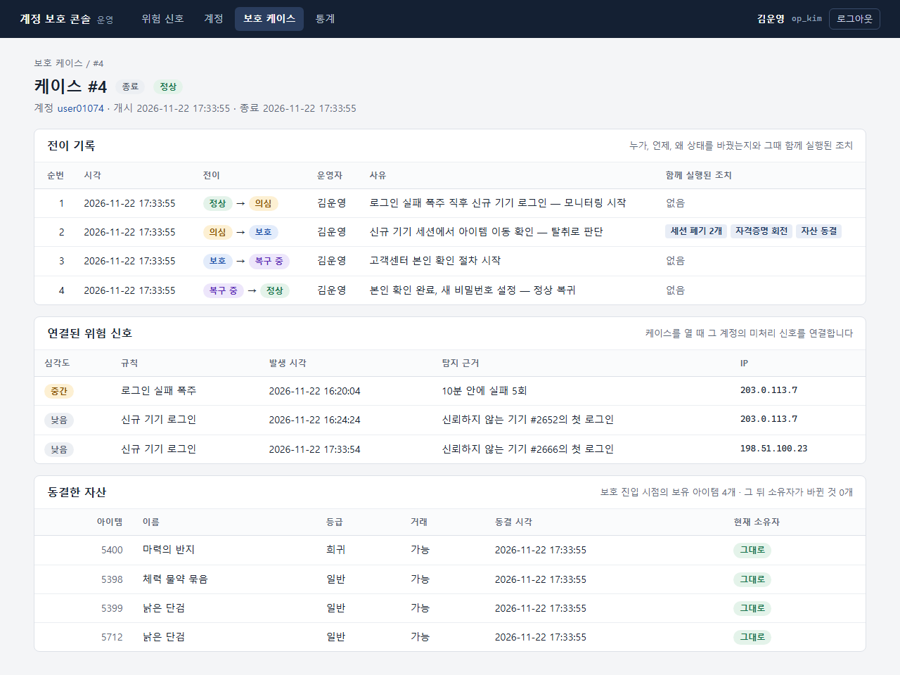 |
| **감사 타임라인 — 보호 이후 공격자의 이동 거절 · 로그인 차단** | **통계** |
| 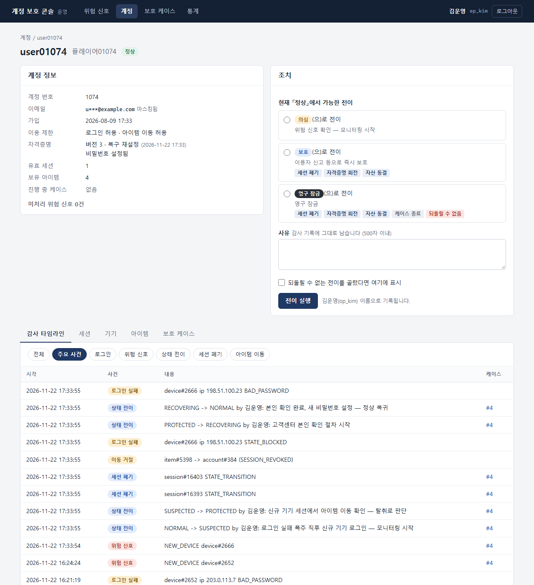 | 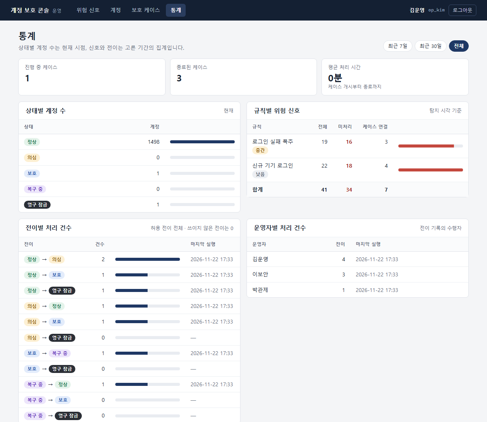 |

위 화면은 데모 흐름을 실제 정책 함수로 실행해 만든 것이다. 공격자가 낯선 기기로 로그인해 아이템 하나를 옮긴 뒤, 운영자가 「의심 → 보호」로 전이하자 공격자 세션 2개가 폐기되고, 이후의 이동은 `SESSION_REVOKED`, 재로그인은 `STATE_BLOCKED`로 거절된다. 복구 뒤에는 옛 비밀번호가 `BAD_PASSWORD`, 소유자의 새 비밀번호는 `OK`.

### 웹 계층의 보안 장치

| 장치 | 구현 |
|---|---|
| 기본 거부 | `LoginRequiredMiddleware` — 로그인 화면 외의 모든 요청에 로그인 요구 |
| 운영자 재확인 | 매 요청마다 `ap.operator`에서 활성 운영자인지 다시 확인. 비활성이 되면 다음 요청에서 세션을 끊는다 |
| 행위자 신원 | 전이 기록의 운영자는 **로그인 세션에서만** 정한다. 폼에 다른 운영자 번호를 끼워 넣어도 무시된다 |
| 낡은 화면 | 화면을 연 뒤 다른 운영자가 상태를 바꿨다면, 낡은 화면에서 보낸 전이를 **같은 트랜잭션에서 롤백**한다. (A가 「의심 → 정상」으로 종료한 직후 B가 낡은 화면에서 「보호」를 누르면, 검사 없이는 B가 의도하지 않은 「정상 → 보호」가 실행된다) |
| 종착 전이 확인 | 「영구 잠금」은 확인란 없이는 실행하지 않는다 |
| 로그인 오류 | 틀린 비밀번호 · 없는 아이디 · 운영자가 아닌 계정을 같은 메시지로 거부 |
| CSRF · 메서드 | 상태 변경과 로그아웃은 POST + CSRF 토큰만. 쿠키는 `SameSite=Strict`, `HttpOnly` |
| 브라우저 정책 | CSP `default-src 'none'; style-src 'self'` — 스크립트를 한 줄도 쓰지 않는다. `X-Frame-Options: DENY`, `Cache-Control: no-store`(로그아웃 뒤 뒤로 가기로 개인정보 화면이 보이지 않게) |
| 세션 | 60분 무활동 만료, 브라우저 종료 시 삭제 |
| DB 접속 | `ap_ops` 역할로만, `lock_timeout` 5초 · `statement_timeout` 15초. Django 관리자 화면(admin)은 설치하지 않았다 |
| 오류 노출 | `DEBUG` 기본 꺼짐. 예상하지 못한 DB 오류는 화면에 내용을 내보내지 않고 서버 로그에만 남긴다 |

ORM 모델은 두지 않았다. 웹 역할에는 `ap` 스키마 쓰기 권한이 없고 변경은 정책 함수로만 일어나므로, 조회 SQL을 그대로 쓰는 편이 권한 구조와 맞는다(`console/queries.py`). 모든 값은 매개변수로 넘기고, 검색어의 `%` · `_`는 와일드카드가 아닌 글자로 처리한다. Django 자체 테이블(인증 · 세션)은 `public` 스키마에 따로 둔다.

## 6. 데이터 모델

18개 테이블, 네 영역.

| 영역 | 테이블 |
|---|---|
| 정책 (코드 테이블) | `protection_state`, `allowed_transition`, `risk_rule`, `item_template`, `operator` |
| 계정 · 인증 | `account`, `credential_history`, `device`, `account_device`, `game_session`, `login_attempt` |
| 탐지 · 대응 | `risk_signal`, `burst_signal`, `protection_case`, `case_transition`, `case_asset_snapshot` |
| 자산 | `item`, `item_transfer` |

모델링에서 신경 쓴 부분:

- **약한 엔티티** — 자격증명 이력(계정 + 버전), 상태 전이 기록(케이스 + 순번), 등록 기기(계정 + 기기).
- **하위 타입** — 실패 폭주 신호의 세부(구간 실패 수, 기간)는 `burst_signal`로 분리하고, 판별자 `rule_code`를 고정값 생성 컬럼(`'FAILED_BURST'`)으로 둬 복합 외래키 `(signal_id, rule_code)`가 실패 폭주 신호에만 붙게 했다.
- **순환 참조** — 계정의 현재 자격증명 버전은 이력에 반드시 있어야 한다(`account(account_id, credential_version) → credential_history`). 이력도 계정을 참조하므로 계정 쪽 검사만 커밋 시점으로 미룬다(`DEFERRABLE INITIALLY DEFERRED`).
- **부분 UNIQUE 인덱스** — 계정당 진행 중인 케이스는 1건: `UNIQUE (account_id) WHERE closed_at IS NULL`. 두 운영자가 동시에 케이스를 여는 경합도 이것으로 막힌다.
- **복합 외래키의 부분 NULL** — 기본 방식(MATCH SIMPLE)에서는 한쪽만 NULL이어도 외래키 검사를 빠져나가므로 `CHECK ((revoked_case_id IS NULL) = (revoked_seq IS NULL))`로 막는다.

<details>
<summary>관계 다이어그램 (실제 DB 카탈로그에서 생성)</summary>

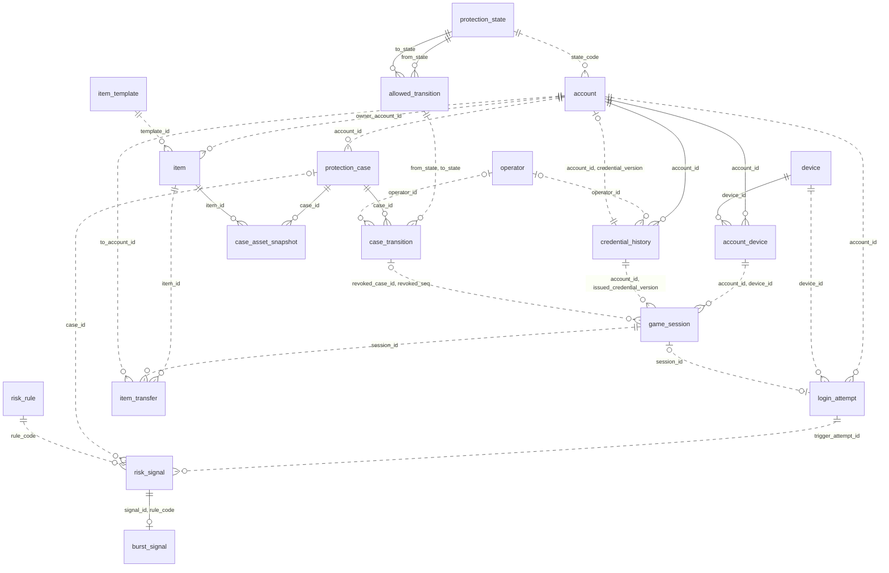

</details>

컬럼까지 포함한 ERD는 [docs/ERD.md](docs/ERD.md), 제약조건 전체 목록은 [docs/schema_catalog.md](docs/schema_catalog.md). 둘 다 실제 DB 카탈로그에서 스크립트로 생성한다.

## 7. 테스트

`pytest`가 실행될 때마다 테스트 DB를 새로 만들고 스키마 전체를 적용한 뒤 검증한다. 모의 객체(mock) 없이 실제 PostgreSQL에 실제 역할로 접속한다.

| 파일 | 개수 | 검증하는 것 |
|---|---:|---|
| `tests/test_policies.py` | 41 | 로그인 · 세션 발급, 탐지 규칙, 상태 전이와 동반 조치, 복구, 아이템 이동 규칙, 역할별 권한(허용 · 거부), 트리거(소유자 직접 UPDATE 거부), 생성 컬럼 쓰기 금지, 삭제 정책, 해시 형식, 동시 로그인 시 시각 역전 방지 |
| `tests/test_concurrency.py` | 5 | 연결 두 개로 경합 재현 — 잠금 대기 관찰(`pg_stat_activity`), 어느 쪽이 먼저든 일관된 결과, 잠금 없는 함수의 write skew(RC · RR), SERIALIZABLE의 직렬화 실패 |
| `tests/test_web.py` | 29 | 운영 콘솔 — 비로그인 · 비운영자 · 비활성 운영자 차단, CSRF, POST 전용, 보안 헤더, 운영자 신원 위조 무시, 낡은 화면 롤백, 거부 화면의 "변경 없음" 증거, 복구 전 과정, 검색 와일드카드 |

```text
$ .venv/Scripts/python -m pytest tests -q
75 passed
```

## 8. 실행 방법

전제: Windows · PostgreSQL 17 · Python 3.10 이상. 접속 포트는 `.env`의 `PG_PORT`(예시 값 5433)로 정한다.

```bash
python -m venv .venv
.venv/Scripts/python -m pip install -r requirements.txt
cp .env.example .env    # 값 채우기: postgres 관리자 비밀번호, 프로젝트 역할 비밀번호, 웹 비밀값
```

`.env`의 postgres 관리자 비밀번호는 역할과 DB를 처음 만들 때만 쓰인다. 스키마 · 함수 · 데이터는 전부 `ap_owner`로 적용된다.

```bash
.venv/Scripts/python scripts/apply.py --reset     # 역할 3개 + 개발 DB 생성, SQL 적용
.venv/Scripts/python scripts/seed.py              # 합성 데이터 적재 (약 10초)
.venv/Scripts/python -m pytest tests -q           # 테스트 DB를 새로 만들어 전체 검증
```

운영 콘솔:

```bash
.venv/Scripts/python manage.py migrate            # Django 자체 테이블(인증 · 세션)을 public 스키마에 생성
.venv/Scripts/python manage.py sync_operators     # ap.operator 의 운영자를 웹 로그인 계정으로 생성
.venv/Scripts/python manage.py runserver 8000     # http://127.0.0.1:8000
```

로그인 아이디는 운영자의 `username`(`op_kim`, `op_lee`, `op_park`), 초기 비밀번호는 `.env`의 `AP_WEB_OPERATOR_PASSWORD`다. 개인 비밀번호로 바꾸려면 `manage.py changepassword <아이디>`. `apply.py --reset`으로 DB를 다시 만들었으면 `migrate`와 `sync_operators`도 다시 실행한다. 다른 포트의 서버에 붙이려면 환경변수 `PG_PORT`를 지정한다(PowerShell: `$env:PG_PORT = 5499`).

### 합성 데이터

`scripts/seed.py`는 30일치 이력을 만들고, 그 안에 정답 라벨이 있는 시나리오를 섞는다. 라벨은 DB가 아니라 `data/seed_scenarios.csv`에 따로 저장한다(탐지 결과와 비교용).

| 시나리오 | 내용 |
|---|---|
| `TAKEOVER` | 로그인 실패 6~12회 → 낯선 기기에서 로그인 성공 → 수집 계정으로 아이템 1~3개 이동 |
| `TAKEOVER_RECENT` | 위와 같지만 몇 시간 전 — 공격자 세션이 아직 유효해 보호 전이로 실제로 폐기된다 |
| `SILENT_TAKEOVER` | 실패 없이 바로 낯선 기기 로그인 → 이동 (실패 폭주 규칙으로는 안 잡히고 신규 기기 규칙으로만 잡힌다) |
| `BURST_ONLY` | 실패 폭주만 있고 로그인 성공은 없음 |
| `BENIGN_NEW_DEVICE` | 본인이 새 휴대폰으로 로그인 (오탐 후보) |

공격자 기기 몇 대를 여러 피해 계정이 공유하도록 만들어, 계정 상세의 기기 탭에서 "같은 기기를 쓴 다른 계정 수"로 공격 연관성이 드러난다.

실제 개인정보는 쓰지 않는다. 이메일은 `example.com`, IP는 사설 대역(10.x)과 문서용 대역(198.51.100.x, 203.0.113.x)만 쓴다. 시드 계정 비밀번호는 로컬 테스트용 규칙(`pw-<login_id>`)이다.

## 9. 프로젝트 구조

```text
account-protection/
├── db/
│   ├── 01_schema.sql            테이블 18개, 이름 붙인 제약조건, 인덱스
│   ├── 02_functions.sql         정책 함수 5개, 트리거 2개 (잠금 규약 주석)
│   ├── 03_views.sql             세션 상태 · 계정 개요(마스킹) · 위험 신호 큐 · 감사 타임라인
│   ├── 04_grants.sql            역할별 최소 권한
│   └── 05_reference_data.sql    상태 · 허용 전이 · 탐지 규칙 · 아이템 종류 · 운영자
├── lab/01_transfer_nolock.sql   경합 실험용 비교 함수 (잠금 없음 + 지연)
├── scripts/
│   ├── apply.py, dbconf.py      역할 · DB 생성과 SQL 적용, 접속 설정(.env)
│   ├── seed.py                  합성 데이터 생성 · 적재 (COPY)
│   └── export_*.py, gen_*.py    DB 카탈로그 → 문서 (ERD, 스키마 목록, 설계서 표)
├── web/                         Django 설정 · URL
├── console/
│   ├── queries.py               조회 SQL
│   ├── actions.py               정책 함수 호출, DB 거부 → 화면 메시지
│   ├── views.py, urls.py, forms.py
│   ├── middleware.py            운영자 재확인, 보안 헤더
│   ├── templates/, static/      화면 (스크립트 없음)
│   └── management/commands/sync_operators.py
├── tests/                       pytest 75개
└── docs/                        ERD, 스키마 목록, 화면, 설계 문서와 생성기(spec/)
```

## 10. 알려진 한계와 다음 단계

**알려진 한계**

- 「의심」 상태에서 **새로 생긴** 위험 신호는 진행 중인 케이스에 연결되지 않는다. 신호 연결이 「정상」에서 벗어나는 순간에만 일어나기 때문이다. 그 신호는 미처리로 남았다가 다음 케이스에 붙는다. 전이할 때마다 연결하도록 고칠 예정이다.
- 한 번이라도 쓰인 허용 전이 행은 삭제 정책(RESTRICT) 때문에 지울 수 없다. 정책을 폐지하려면 사용 여부 컬럼이 필요하다.
- 소유자 계정은 스키마 변경 권한으로 트리거를 끌 수 있다. 그래서 앱은 소유자 계정을 쓰지 않는다.
- 운영 콘솔의 로그인 시도 횟수 제한, 운영자의 **열람** 기록(누가 어떤 계정을 봤는지)은 아직 없다.

**다음 단계**

- 게임 클라이언트 시뮬레이터: 공격자 창과 소유자 창을 나란히 띄워 보호 전이 순간 공격자 세션이 끊기는 장면 시연 (`ap_game` 역할)
- 로그인 시도 200만 행에서 인덱스 전후 `EXPLAIN (ANALYZE, BUFFERS)` 비교
- 운영자 열람 감사 로그

## 11. 수업 산출물과 문서 생성

Database Design and System 텀프로젝트로 진행했다. 단계별 제출물과 생성기는 `docs/`에 있다.

| 단계 | 산출물 |
|---|---|
| 요구사항 · 업무 규칙 · EER | `docs/spec/content.js` → `build_spec.js` / `build_submit.js` (Chen 표기 EER은 `eer.py`) |
| 정규화 (UNF → BCNF, 함수 종속 19개) | `docs/spec/content_norm.js` → `build_norm.js` |
| 물리 설계 (모든 컬럼 · 제약 명세 · 참조 무결성/삭제 정책) | `docs/spec/content_phys.js` → `build_phys.js` |
| 5주차 개념 · 논리 설계 (스키마 변경 전) | `docs/05_conceptual_design.pdf`, `docs/05_logical_design.pdf` |

문서의 타입 · 키 · 외래키 동작은 손으로 옮겨 적지 않고 실제 DB 카탈로그(`scripts/export_physical_json.py`)에서 채운다. 사람이 쓴 설명과 카탈로그가 어긋나면(빠진 컬럼 · 제약, 없는 이름) **문서 빌드가 실패**하도록 해, 문서와 구현이 따로 놀지 않게 했다.

생성형 AI 사용 내역(도구 · 프롬프트 · 활용 방식)은 수업 정책에 따라 [docs/AI_USAGE.md](docs/AI_USAGE.md)에 기록한다.
