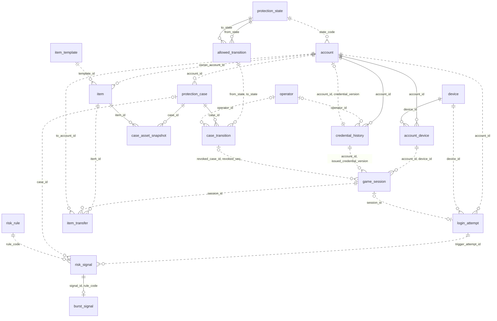
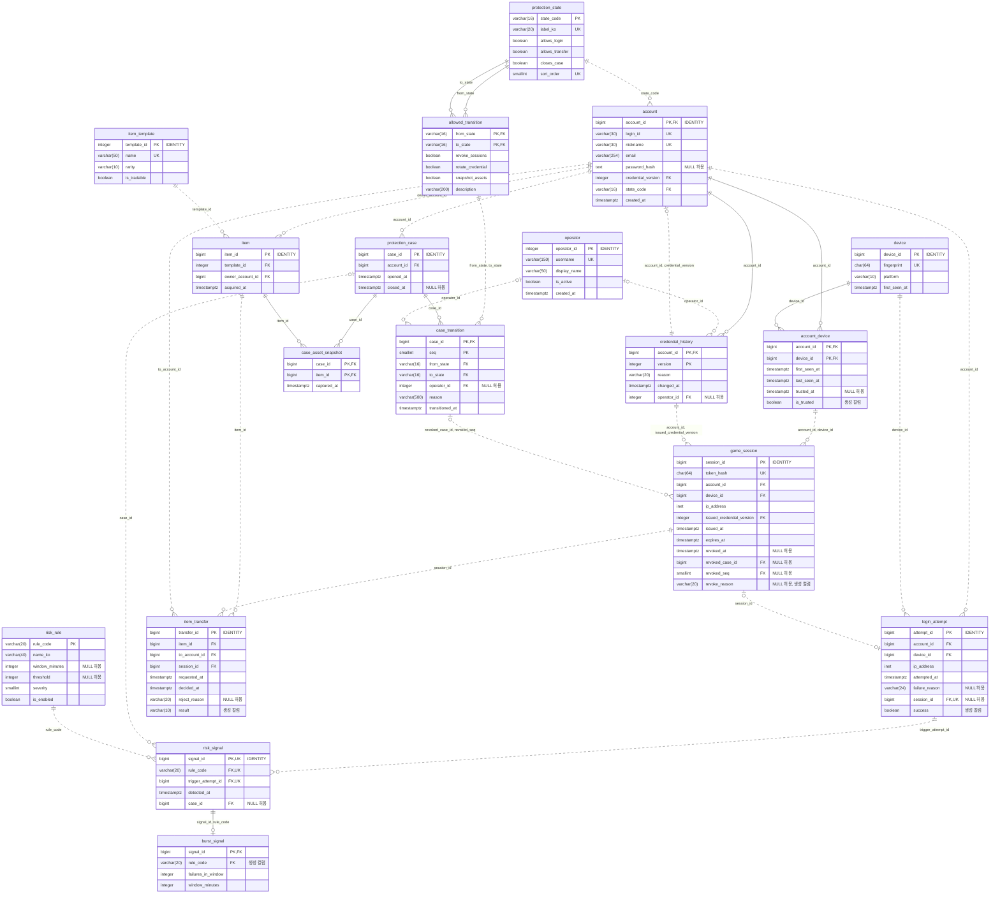

# ERD (물리 스키마)

`scripts/export_erd_mermaid.py`가 실제 DB 카탈로그(`docs/spec/phys_catalog.json`)에서 만든다. 손으로 그리지 않는다.

테이블 18개 · PK 18 · FK 29 · UNIQUE 11 + 부분 UNIQUE 1 · CHECK 27

실선은 식별 관계(외래키가 기본키의 일부), 점선은 비식별 관계다.

## 관계만

## 컬럼 포함

